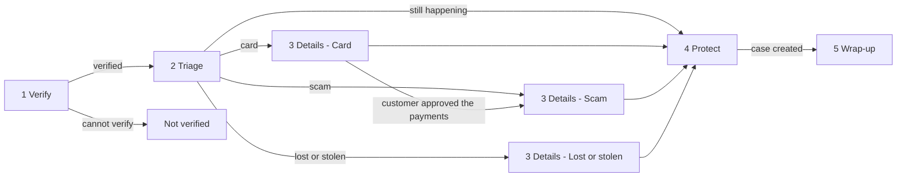

# Fraud Desk - Inbound: Script Designer build guide

> Generated from `script/definition.mjs` by `node tools/build.mjs`. Edit the definition, not this file.

A native Genesys Cloud script for agents taking inbound fraud reports at a bank. It covers card payments the customer does not recognize, scams where the customer sent the money, and lost or stolen cards and phones. A clickable preview of the finished script is in `preview/index.html`.

## Contents

1. [How the script flows](#1-how-the-script-flows)
2. [Before you build](#2-before-you-build)
3. [Styles](#3-styles)
4. [Variables](#4-variables)
5. [Custom actions](#5-custom-actions)
6. [Data actions](#6-data-actions)
7. [Page frame](#7-page-frame)
8. [Pages](#8-pages)
9. [Case notes text](#9-case-notes-text)
10. [Architect wiring](#10-architect-wiring)
11. [Compliance and data handling](#11-compliance-and-data-handling)
12. [Test plan](#12-test-plan)
13. [Confirm in your org](#13-confirm-in-your-org)

## 1. How the script flows



Design rules the script follows:

- **Protect before paperwork.** The card block and the payment recall are offered as soon as the script knows they apply, not at the end.
- **One question at a time, in the customer's words.** Each blue SAY block is read aloud. Everything else is for the agent.
- **Show only what applies.** Follow-up questions, warnings and protective actions appear through the Visible property, so the agent never scrolls past irrelevant fields.
- **No blame, no promises.** Scam wording reassures the customer and never commits to a refund.
- **Nothing sensitive is stored.** No full card numbers, PINs, security codes or passcodes. Only non-personal outcomes are saved as participant data.

## 2. Before you build

| Item | What to do |
|---|---|
| Script | Admin > Contact Center > Scripts > Create. Name it **Fraud Desk - Inbound**. Start from a blank script. |
| Script properties | Turn on **Inbound** (makes Secure Pause and End Secure Pause available). Turn on **Data Actions** when you reach phase 2. |
| Queue | A queue named **Fraud Specialists** for the transfer button on Wrap-up. |
| Team lead alert | Build the **Fraud - Alert Team Lead** data action (section 6) and decide which mailbox or phone receives alerts on each shift. |
| Team lead permissions | Conversation > Call > Monitor, Coach and Barge, plus the queue activity view, so a lead can act on an alert. |
| Wrap-up codes | **Fraud - Card**, **Fraud - Scam**, **Fraud - Lost or Stolen**, **Fraud - Other**, **Fraud - Verification failed**. Assign them to the fraud queue. |
| Agent permissions (phase 2) | Integrations > Action > View and Bridge > Actions > Execute, so agents can run data actions from the script. |
| Market settings | Set the default value of each `cfg_` variable (section 4). The time frames are placeholders until Compliance confirms them. |

**Import instead of building by hand.** `script/fraud-desk-inbound.script` contains everything in this guide: all pages, components, styles, variables and custom actions. In Admin > Contact Center > Scripts choose **Import**, select the file and name the script. Then finish the parts a file cannot carry, because they belong to your org:

1. Open `ca_TransferToSpecialist` and choose the queue in the Blind Transfer step.
2. Build the **Fraud - Alert Team Lead** data action (section 6), turn on the script's **Data Actions** property, then in `ca_AlertTeamLead` replace the placeholder alert with Execute Data Action followed by Set Variable `tl_Requested` = true. Until you do, the button tells the agent it is not connected.
3. Set the `cfg_` variable defaults for your market.
4. Check each page in preview against `preview/index.html`, then publish and point the Architect flow at the script.
5. Later, add the banking data actions where each custom action has a "Phase 2" comment.

The file was generated from the format of Genesys's own published script exports and the Scripter editor's property definitions, and it passes a structural check against both. It has not been imported into a live org, so if the import is rejected or a component looks wrong, the sections below let you fix or rebuild that part by hand.

**Build order (manual build).** Variables first, then custom actions, then the page frame on page 1. Copy the frame containers and paste them into each new page (toolbar Cut, Copy, Paste), then add the page content. Publish, then point the Architect flow at the script.

**Phase 1 and phase 2.** In phase 1 the six protective custom actions only set their flag: the agent does the step in the banking system and clicks the button to record it. In phase 2 each custom action runs its data action first. Pages and wording do not change between phases. The team lead alert is the exception: it has no manual equivalent, so its data action is needed from day one.

## 3. Styles

Script Designer has no shared stylesheet, so these names are a convention. Set the listed properties on each component that uses the style. A **Chip** is a Text component with a background color and padding, sized to its content (Width: Auto). Padding and margin are in pixels, written top right bottom left.

| Style | Used on | Background | Text color | Font size | Bold | Padding | Margin | Width |
|---|---|---|---|---|---|---|---|---|
| `canvas` | container | #F3F5F9 |  |  |  | 0 |  |  |
| `header` | container | #101B3B |  |  |  | 14 20 |  |  |
| `hTitle` | text |  | #FFFFFF | 18 | Yes |  |  |  |
| `hSub` | text |  | #B7C0DA | 12 |  |  |  |  |
| `hMeta` | text |  | #FFFFFF | 13 |  |  |  |  |
| `stepper` | container | #FFFFFF |  |  |  | 10 20 |  |  |
| `stepDone` | chip | #E3F5EA | #0E6B3A | 12 | Yes | 4 10 |  |  |
| `stepNow` | chip | #2447D8 | #FFFFFF | 12 | Yes | 4 10 |  |  |
| `stepNext` | chip | #FFFFFF | #7A8397 | 12 |  | 4 10 |  |  |
| `body` | container |  |  |  |  | 20 |  |  |
| `main` | container |  |  |  |  |  | 0 16 0 0 | Stretch, weight 2 |
| `side` | container |  |  |  |  |  |  | Stretch, weight 1 |
| `card` | container | #FFFFFF |  |  |  | 20 | 0 0 16 0 |  |
| `say` | container | #EAF0FF |  |  |  | 16 | 0 0 16 0 |  |
| `sayLabel` | text |  | #2447D8 | 11 | Yes |  |  |  |
| `sayText` | text |  | #131A2B | 16 |  |  |  |  |
| `h2` | text |  | #131A2B | 16 | Yes |  | 0 0 6 0 |  |
| `label` | text |  | #131A2B | 13 | Yes |  |  |  |
| `muted` | text |  | #5B6478 | 13 |  |  |  |  |
| `bodyText` | text |  | #131A2B | 14 |  |  |  |  |
| `field` | container |  |  |  |  |  | 12 0 0 0 |  |
| `row` | container |  |  |  |  |  | 12 0 0 0 |  |
| `bannerOk` | container | #E3F5EA | #0E6B3A | 13 |  | 12 | 12 0 0 0 |  |
| `bannerWarn` | container | #FFF1D6 | #8A4B00 | 13 |  | 12 | 12 0 0 0 |  |
| `bannerBad` | container | #FDE7E4 | #A3221A | 13 |  | 12 | 12 0 0 0 |  |
| `bannerInfo` | container | #EDEFF4 | #3D4558 | 13 |  | 12 | 12 0 0 0 |  |
| `chipOk` | chip | #E3F5EA | #0E6B3A | 12 | Yes | 4 10 | 2 0 2 0 |  |
| `chipWarn` | chip | #FFF1D6 | #8A4B00 | 12 | Yes | 4 10 | 2 0 2 0 |  |
| `chipBad` | chip | #FDE7E4 | #A3221A | 12 | Yes | 4 10 | 2 0 2 0 |  |
| `btnPrimary` | button | #2447D8 | #FFFFFF | 14 | Yes |  |  |  |
| `btnSecondary` | button | #E6E9F0 | #131A2B | 14 |  |  |  |  |
| `btnDanger` | button | #B42318 | #FFFFFF | 14 | Yes |  |  |  |
| `btnAssist` | button | #101B3B | #FFFFFF | 14 | Yes |  | 12 0 0 0 |  |
| `footer` | container |  |  |  |  | 0 20 20 20 |  |  |

Palette: ink `#131A2B`, muted `#5B6478`, canvas `#F3F5F9`, accent `#2447D8`, good `#0E6B3A` on `#E3F5EA`, caution `#8A4B00` on `#FFF1D6`, critical `#A3221A` on `#FDE7E4`. All text and background pairs meet WCAG AA contrast.

## 4. Variables

### Input

| Name | Type | Default | Input | Output | Description |
|---|---|---|---|---|---|
| `in_CustomerId` | String | (empty) | Yes |  | Internal customer ID from IVR identification. Not PII. |
| `in_CustomerName` | String | (empty) | Yes |  | Display name. Optional: prefer a data action lookup over passing PII as participant data. |
| `in_CardLast4` | String | (empty) | Yes |  | Last four digits of the primary card. Never pass the full card number. |
| `in_VerifiedLevel` | String | none | Yes |  | IVR verification result: full, partial or none. |
| `in_IvrIntent` | String | (empty) | Yes |  | Reason chosen in the IVR: card, scam, lost or empty. Pre-selects the triage answer. |

### Config

| Name | Type | Default | Input | Output | Description |
|---|---|---|---|---|---|
| `cfg_BankName` | String | Example Bank |  |  | Bank name used in greetings. |
| `cfg_Currency` | String | $ |  |  | Currency symbol shown before amounts. |
| `cfg_DecisionTimeframe` | String | 10 business days |  |  | PLACEHOLDER. Time to tell the customer the outcome. Set from your market rules. |
| `cfg_CardDeliveryEta` | String | 5 to 7 business days |  |  | PLACEHOLDER. Replacement card delivery time. |
| `cfg_ReportingBody` | String | your national fraud reporting service or local police |  |  | PLACEHOLDER. Where customers report scams in your market. |

### Verify

| Name | Type | Default | Input | Output | Description |
|---|---|---|---|---|---|
| `callerType` | String | holder |  |  | holder = account holder, third = calling on their behalf. |
| `idv_Identity` | True/False | false |  |  | Full name and date of birth confirmed. |
| `idv_Address` | True/False | false |  |  | Registered address confirmed. |
| `idv_Knowledge` | True/False | false |  |  | Account knowledge question answered. |

### Triage

| Name | Type | Default | Input | Output | Description |
|---|---|---|---|---|---|
| `fraudType` | String | (empty) |  | Yes | card, scam or lost. Saved as participant data. |
| `fraudOngoing` | String | (empty) |  |  | yes, no or unsure. |

### Card

| Name | Type | Default | Input | Output | Description |
|---|---|---|---|---|---|
| `card_HasCard` | String | (empty) |  |  | Customer still has the card: yes / no. |
| `card_OthersAccess` | String | (empty) |  |  | Someone else knows the PIN or uses the card: yes / no. |
| `card_SharedDetails` | String | (empty) |  |  | Card details, PIN or passcode shared recently: yes / no. |
| `card_TxnCount` | Number | 0 |  |  | Number of payments not recognized. |
| `card_TotalAmount` | Number | 0 |  |  | Total of payments not recognized (whole currency units). |
| `card_FirstTxnDate` | String | (empty) |  |  | Date of the first payment not recognized. |
| `card_Channel` | String | (empty) |  |  | How the payments were made. |
| `card_RuledOut` | True/False | false |  |  | Trading names, family use, subscriptions and free trials ruled out. |
| `card_Notes` | String | (empty) |  |  | Free-text notes. No card numbers, PINs or codes. |

### Scam

| Name | Type | Default | Input | Output | Description |
|---|---|---|---|---|---|
| `scam_PayMethod` | String | (empty) |  |  | transfer, card, crypto, cash, giftcard or other. |
| `scam_LastPayment` | String | (empty) |  |  | hour, today, week or older. |
| `scam_Amount` | Number | 0 |  |  | Total sent (whole currency units). |
| `scam_PaymentCount` | Number | 0 |  |  | Number of payments sent. |
| `scam_PaidTo` | String | (empty) |  |  | Name the customer paid, as shown on the payment. |
| `scam_Type` | String | (empty) |  | Yes | Scam category. Saved as participant data. |
| `scam_Contact` | String | (empty) |  |  | How the scammer first made contact. |
| `scam_StillInContact` | String | (empty) |  |  | yes / no. |
| `scam_RemoteAccess` | String | (empty) |  |  | Software installed or screen shared: yes / no. |
| `scam_SharedCreds` | String | (empty) |  |  | Login details or passcodes shared: yes / no. |
| `scam_MorePending` | String | (empty) |  |  | Further payments scheduled or pending: yes / no. |
| `scam_Coached` | String | (empty) |  |  | Customer was told what to say to the bank: yes / no. |
| `support_Needed` | True/False | false |  |  | Customer may need extra support. Record in the case system, not participant data. |
| `support_Notes` | String | (empty) |  |  | Support needs in the customer's own words. |
| `scam_Notes` | String | (empty) |  |  | Free-text notes. |

### Lost

| Name | Type | Default | Input | Output | Description |
|---|---|---|---|---|---|
| `lost_What` | String | (empty) |  |  | card, phone or both. |
| `lost_How` | String | (empty) |  |  | lost or stolen. |
| `lost_When` | String | (empty) |  |  | When the customer last had it. |
| `lost_PinExposed` | String | (empty) |  |  | PIN written down or kept with the card: yes / no. |
| `lost_PhoneLocked` | String | (empty) |  |  | Phone protected by passcode or biometrics: yes / no. |
| `lost_Wallet` | String | (empty) |  |  | Card is in a mobile wallet on the phone: yes / no. |
| `lost_Unrecognized` | String | (empty) |  |  | Payments since then the customer does not recognize: yes / no. |
| `lost_PoliceRef` | String | (empty) |  |  | Police report reference, if stolen. |

### Protect

| Name | Type | Default | Input | Output | Description |
|---|---|---|---|---|---|
| `act_CardBlocked` | True/False | false |  | Yes | Card block completed. Saved as participant data. |
| `act_ReplacementOrdered` | True/False | false |  |  | Replacement card ordered. |
| `act_AddressConfirmed` | True/False | false |  |  | Delivery address confirmed with the customer. |
| `act_RecallRaised` | True/False | false |  | Yes | Payment recall raised. Saved as participant data. |
| `act_DigitalLocked` | True/False | false |  |  | Online and mobile banking locked. |
| `act_WalletRemoved` | True/False | false |  |  | Card removed from mobile wallets. |
| `act_CaseCreated` | True/False | false |  |  | Fraud case created. |
| `caseRef` | String | (empty) |  | Yes | Fraud case reference. Saved as participant data. |
| `out_AmountAtRisk` | Number | 0 |  | Yes | Copy of dyn_AmountAtRisk, saved as participant data when the case is created. |

### Assistance

| Name | Type | Default | Input | Output | Description |
|---|---|---|---|---|---|
| `tl_Requested` | True/False | false |  | Yes | Agent alerted a team lead during the interaction. Saved as participant data. |
| `tl_Reason` | String | (empty) |  |  | Optional reason sent with the alert. |

### Wrap-up

| Name | Type | Default | Input | Output | Description |
|---|---|---|---|---|---|
| `adviceGiven` | True/False | false |  |  | Safety advice read to the customer. |
| `outcome` | String | (empty) |  | Yes | completed, failed_idv or transferred. Saved as participant data. |

### Dynamic

| Name | Type | Expression | Purpose |
|---|---|---|---|
| `dyn_IsVerified` | True/False | `equal({{in_VerifiedLevel}}, "full") or ({{idv_Identity}} and {{idv_Address}} and {{idv_Knowledge}})` | Caller is verified by IVR or by all three agent checks. |
| `dyn_LockVerify` | True/False | `not (equal({{in_VerifiedLevel}}, "full") or ({{idv_Identity}} and {{idv_Address}} and {{idv_Knowledge}}))` | Disables Continue on Verify until verified. |
| `dyn_LockTriage` | True/False | `equal({{fraudType}}, "")` | Disables Continue on Triage until a type is chosen. |
| `dyn_CardAtRisk` | True/False | `equal({{fraudType}}, "card") or (equal({{fraudType}}, "lost") and not equal({{lost_What}}, "phone")) or (equal({{fraudType}}, "scam") and equal({{scam_PayMethod}}, "card"))` | The card needs blocking and replacing. |
| `dyn_RecallApplies` | True/False | `equal({{fraudType}}, "scam") and equal({{scam_PayMethod}}, "transfer")` | A payment recall can be attempted. |
| `dyn_UrgentRecall` | True/False | `equal({{fraudType}}, "scam") and equal({{scam_PayMethod}}, "transfer") and not {{act_RecallRaised}} and (equal({{scam_LastPayment}}, "hour") or equal({{scam_LastPayment}}, "today"))` | Recent transfer with no recall raised yet. |
| `dyn_DigitalAtRisk` | True/False | `(equal({{fraudType}}, "scam") and (equal({{scam_RemoteAccess}}, "yes") or equal({{scam_SharedCreds}}, "yes"))) or (equal({{fraudType}}, "lost") and (equal({{lost_What}}, "phone") or equal({{lost_What}}, "both")))` | Online and mobile banking should be locked. |
| `dyn_WalletAtRisk` | True/False | `equal({{fraudType}}, "lost") and equal({{lost_Wallet}}, "yes")` | Mobile wallet tokens should be removed. |
| `dyn_LockReplacement` | True/False | `not {{act_CardBlocked}}` | Disables Order replacement until the card is blocked. |
| `dyn_LockWrapUp` | True/False | `not {{act_CaseCreated}}` | Disables Continue on Protect until a case exists. |
| `dyn_AmountAtRisk` | Number | `ifElse(equal({{fraudType}}, "scam"), {{scam_Amount}}, {{card_TotalAmount}})` | Amount reported, from whichever path was used. |
| `dyn_TypeLabel` | String | `ifElse(equal({{fraudType}}, "card"), "Card payments not recognized", ifElse(equal({{fraudType}}, "scam"), "Scam payment", ifElse(equal({{fraudType}}, "lost"), "Lost or stolen", "Not set yet")))` | Readable fraud type for the summary. |
| `dyn_WrapUp` | String | `ifElse(equal({{fraudType}}, "card"), "Fraud - Card", ifElse(equal({{fraudType}}, "scam"), "Fraud - Scam", ifElse(equal({{fraudType}}, "lost"), "Fraud - Lost or Stolen", "Fraud - Other")))` | Wrap-up code the agent should select. |

Text comparisons use `equal()`, which Genesys provides for strict matching. Combine conditions with `and`, `or` and `not`.

## 5. Custom actions

### ca_StartTriage

Leaves Verify. Pre-selects the triage answer from the IVR when nothing is chosen yet.

- **If** `equal({{fraudType}}, "") and not equal({{in_IvrIntent}}, "")` (Dynamic Expression)
  - Scripter.Set Variable: `fraudType` = `{{in_IvrIntent}}` (expression)
- Scripter.Change Page: *Triage*

### ca_GoToDetails

Routes from Triage to the page for the chosen fraud type.

- **If** `equal({{fraudType}}, "card")` (Dynamic Expression)
  - Scripter.Change Page: *Details - Card*
- **Else**
  - **If** `equal({{fraudType}}, "scam")` (Dynamic Expression)
    - Scripter.Change Page: *Details - Scam*
  - **Else**
    - Scripter.Change Page: *Details - Lost or stolen*

### ca_BackToDetails

Back button on Protect. Returns to the details page for the chosen type, or Triage if none.

- **If** `equal({{fraudType}}, "")` (Dynamic Expression)
  - Scripter.Change Page: *Triage*
- **Else**
  - Custom action `ca_GoToDetails`

### ca_SwitchToScam

Card path found the customer approved the payments under instruction.

- Scripter.Set Variable: `fraudType` = "scam"
- Scripter.Set Variable: `scam_PayMethod` = "card"
- Scripter.Change Page: *Details - Scam*

### ca_BlockCard

Blocks the card.

- Data Actions.Execute Data Action: *Fraud - Block Card*, then Scripter.Set Variable `act_CardBlocked` = true

### ca_OrderReplacement

Orders the replacement card.

- Data Actions.Execute Data Action: *Fraud - Order Replacement Card*, then Scripter.Set Variable `act_ReplacementOrdered` = true

### ca_RaiseRecall

Raises the payment recall.

- Data Actions.Execute Data Action: *Fraud - Raise Payment Recall*, then Scripter.Set Variable `act_RecallRaised` = true

### ca_LockDigital

Locks online and mobile banking.

- Data Actions.Execute Data Action: *Fraud - Lock Digital Access*, then Scripter.Set Variable `act_DigitalLocked` = true

### ca_RemoveWallet

Removes the card from mobile wallets.

- Data Actions.Execute Data Action: *Fraud - Remove Wallet Tokens*, then Scripter.Set Variable `act_WalletRemoved` = true

### ca_CreateCase

Creates the fraud case and stores the reference and amount for reporting.

- Scripter.Set Variable: `out_AmountAtRisk` = `{{dyn_AmountAtRisk}}` (expression)
- Data Actions.Execute Data Action: *Fraud - Create Case*, then Scripter.Set Variable `caseRef` = the returned value, `act_CaseCreated` = true

### ca_AlertTeamLead

Sends a silent alert to the team leads. The call is not touched: no hold, no transfer, nothing the customer can hear.

- Data Actions.Execute Data Action: *Fraud - Alert Team Lead*, then Scripter.Set Variable `tl_Requested` = true

### ca_TransferToSpecialist

Records the outcome and transfers the call to the specialist queue.

- Scripter.Set Variable: `outcome` = "transferred"
- Scripter.Blind Transfer: queue *Fraud Specialists*

### ca_BackToVerify

Leaves the Not verified page and clears the failed outcome.

- Scripter.Set Variable: `outcome` = ""
- Scripter.Change Page: *Verify*

### ca_FailedVerification

Records that the caller could not be verified.

- Scripter.Set Variable: `outcome` = "failed_idv"
- Scripter.Change Page: *Not verified*

### ca_Finish

Marks the script complete.

- Scripter.Set Variable: `outcome` = "completed"
- Scripter.Alert: "Fraud report {{caseRef}} is complete. Select wrap-up code "{{dyn_WrapUp}}"."

### ca_CopyNotes

Copies the case notes for the chosen fraud type to the clipboard.

- **If** `equal({{fraudType}}, "card")` (Dynamic Expression)
  - Copy to Clipboard: the case notes text for this fraud type (see Case notes text)
- **Else**
  - **If** `equal({{fraudType}}, "scam")` (Dynamic Expression)
    - Copy to Clipboard: the case notes text for this fraud type (see Case notes text)
  - **Else**
    - Copy to Clipboard: the case notes text for this fraud type (see Case notes text)

For the six protective actions that run a data action, wrap the steps in **Try / On Error** in phase 2. In On Error add a Scripter.Alert telling the agent to complete the step in the banking system, and do not set the flag. For `ca_AlertTeamLead`, always use Try / On Error, with the alert text "Alert not sent. Message your team lead directly."

## 6. Data actions

Build these in Admin > Integrations > Actions against your banking APIs (Web Services Data Actions integration). Write-back actions need POST endpoints. Data actions cannot run in script preview, so test them on a real interaction.

| Data action | Inputs | Outputs | Purpose |
|---|---|---|---|
| Fraud - Block Card | customerId, cardLast4, reason | status | Blocks the card in the card platform. |
| Fraud - Order Replacement Card | customerId, cardLast4 | status | Orders a replacement to the registered address. |
| Fraud - Raise Payment Recall | customerId, amount | recallRef | Sends a recall request to the receiving bank. |
| Fraud - Lock Digital Access | customerId | status | Locks online and mobile banking and signs out all devices. |
| Fraud - Remove Wallet Tokens | customerId, cardLast4 | status | Deletes the card from mobile wallets. |
| Fraud - Alert Team Lead | agentName, queueName, conversationId, fraudType, reason | id | Sends the assistance alert to the team leads. Runs on the Genesys Cloud Data Actions integration, not a banking API. Needed from day one. |
| Fraud - Create Case | customerId, conversationId, fraudType, scamType, amount | caseRef | Creates the fraud case and returns its reference. |

Map `customerId` to `in_CustomerId`, `cardLast4` to `in_CardLast4`, `conversationId` to `{{Scripter.Interaction Id}}`, `fraudType` to `fraudType`, `scamType` to `scam_Type` and `amount` to `out_AmountAtRisk`.

### Team lead alert

`Fraud - Alert Team Lead` is built on the **Genesys Cloud Data Actions** integration (Admin > Integrations), which calls the Genesys Cloud API itself using an OAuth client-credentials client. Nothing outside Genesys Cloud is involved. The call is not touched: no hold, no transfer, nothing the customer can hear.

A ready-made export of the email version is in `data-actions/Fraud-Alert-Team-Lead.custom.json`. In Admin > Integrations > Actions choose **Import**, select the file and pick your Genesys Cloud Data Actions integration. Then edit the two placeholder addresses in the request body (`fraud-alerts@YOUR-AGENTLESS-DOMAIN` and `fraud-team-leads@YOUR-BANK`), run it from the Test tab, and publish it.

Pick one channel for the alert:

| Channel | API call | Needs | Notes |
|---|---|---|---|
| Email to the team lead mailbox | `POST /api/v2/conversations/emails/agentless` | An email domain enabled for agentless sending | Send to one shared mailbox or distribution list. |
| SMS to the duty lead | `POST /api/v2/conversations/messages/agentless` | An SMS number in Genesys Cloud | Easiest to notice away from the desk. |

Request body starting points. Check the field names in API Explorer before publishing the data action.

```json
{
  "senderType": "Outbound",
  "fromAddress": { "email": "fraud-alerts@YOUR-GENESYS-EMAIL-DOMAIN", "name": "Fraud Desk" },
  "toAddresses": [ { "email": "fraud-team-leads@YOUR-BANK" } ],
  "subject": "Assistance needed: ${input.agentName}",
  "textBody": "${input.agentName} on ${input.queueName} has asked for a team lead. Reason: ${input.reason}. Fraud type: ${input.fraudType}. Conversation: ${input.conversationId}"
}
```

```json
{
  "fromAddress": "+YOUR-GENESYS-SMS-NUMBER",
  "toAddress": "+DUTY-LEAD-MOBILE",
  "toAddressMessengerType": "sms",
  "textBody": "${input.agentName} on ${input.queueName} needs a team lead. Reason: ${input.reason}. Conversation: ${input.conversationId}"
}
```

Map `agentName` to `{{Scripter.Agent Name}}`, `queueName` to `{{Scripter.Queue Name}}`, `conversationId` to `{{Scripter.Interaction Id}}`, `fraudType` to `{{dyn_TypeLabel}}` and `reason` to `tl_Reason`. The alert carries no customer details.

**What the team lead does.** Opens the queue activity view for the fraud queue, finds the agent's call and chooses Monitor (listen silently), Coach (speak to the agent only) or Barge (join the call), or walks over. `tl_Requested` is saved as participant data so you can report on how often and on which fraud types agents ask for help.

## 7. Page frame

Every page has the same root structure. Only the highlighted step and the content of `main` and `footer` change.

```
Vertical stack  canvas            (root container, background #F3F5F9)
├─ Horizontal stack  header
├─ Horizontal stack  stepper
├─ Horizontal stack  body
│  ├─ Vertical stack  main      (page content, weight 2)
│  └─ Vertical stack  side      (case summary, weight 1)
└─ Horizontal stack  footer     (navigation buttons, aligned right)
```

### Header

- **Horizontal stack** `header`
  - **Vertical stack** · Width: Stretch, weight 1
    - **Text** `hTitle` "Fraud Desk"
    - **Text** `hSub` "Inbound fraud report"
  - **Vertical stack** · Width: Stretch, weight 1
    - **Text** `hMeta` "{{in_CustomerName}}  ·  Card ending {{in_CardLast4}}" · Align: right
    - **Text** `hSub` "On call {{Scripter.Customer Call Duration}}" · Align: right

### Stepper

Five chips. Steps already passed use `stepDone`, the current step uses `stepNow`, later steps use `stepNext`. Shown here as it appears on page 1.

- **Horizontal stack** `stepper`
  - **Chip** `stepNow` "1  Verify"
  - **Chip** `stepNext` "2  Triage"
  - **Chip** `stepNext` "3  Details"
  - **Chip** `stepNext` "4  Protect"
  - **Chip** `stepNext` "5  Wrap-up"

### Side panel

- **Vertical stack** `side`
  - **Vertical stack** `card`
    - **Text** `h2` "Case so far"
    - **Vertical stack** `row`
      - **Chip** `chipOk` "Verified" · Visible: `{{dyn_IsVerified}}`
      - **Chip** `chipWarn` "Not verified" · Visible: `not {{dyn_IsVerified}}`
      - **Chip** `chipOk` "Card blocked" · Visible: `{{act_CardBlocked}}`
      - **Chip** `chipBad` "Card still active" · Visible: `{{dyn_CardAtRisk}} and not {{act_CardBlocked}}`
      - **Chip** `chipOk` "Recall raised" · Visible: `{{act_RecallRaised}}`
      - **Chip** `chipBad` "Recall needed" · Visible: `{{dyn_UrgentRecall}}`
      - **Chip** `chipOk` "Banking locked" · Visible: `{{act_DigitalLocked}}`
      - **Chip** `chipWarn` "Team lead alerted" · Visible: `{{tl_Requested}}`
    - **Markdown** · Margin: 12 0 0 0

      ```
      **Type**  {{dyn_TypeLabel}}
      **Amount reported**  {{cfg_Currency}}{{dyn_AmountAtRisk}}
      ```

    - **Markdown** · Visible: `{{act_CaseCreated}}`

      ```
      **Reference**  {{caseRef}}
      ```

  - **Vertical stack** `card`
    - **Text** `h2` "Need a team lead?"
    - **Text** `muted` "Sends a silent alert with your name and this call. The customer stays on the line and hears nothing."
    - **Vertical stack** `field`
      - **Text** `label` "Reason (optional)"
      - **Dropdown** · variable `tl_Reason` · options "Customer distressed or abusive" = `Customer distressed or abusive`, "High value or complex case" = `High value or complex case`, "Caller may not be the customer" = `Caller may not be the customer`, "Need a decision or approval" = `Need a decision or approval`, "Something else" = `Other`
    - **Button** `btnAssist` "Alert team lead" · Click Action: Custom action `ca_AlertTeamLead` · Visible: `not {{tl_Requested}}`
    - **Vertical stack** `bannerOk` · Visible: `{{tl_Requested}}`
      - **Text** "Team lead alerted. Carry on with the call. They will listen in, join the call or come over to you." · text color and size from `bannerOk`
      - **Button** `btnSecondary` "Alert again" · Click Action: Custom action `ca_AlertTeamLead` · Margin: 8 0 0 0
  - **Vertical stack** `card`
    - **Text** `h2` "Never ask for"
    - **Markdown**

      ```
      - A full PIN or password
      - The card security code
      - A one-time passcode
      
      If the customer starts to read one out, stop them. Keep these out of your notes too.
      ```


### SAY block

Wherever a page lists a Vertical stack with style `say`, it contains a Text `sayLabel` reading "SAY" and a Text `sayText` with the wording. Agents read these aloud.

## 8. Pages

### Page 1: Verify

Stepper: step 1 is current. This is the start page.

**Main column**

- **Vertical stack** `say`
  - **Text** `sayLabel` "SAY"
  - **Text** `sayText` "Thank you for calling the fraud team at {{cfg_BankName}}. My name is {{Scripter.Agent Name}}. I'm sorry you've had to call about this. First I'll make sure your money is safe, then I'll take the details."
- **Vertical stack** `card`
  - **Text** `h2` "Confirm who you are speaking to"
  - **Vertical stack** `bannerOk` · Visible: `equal({{in_VerifiedLevel}}, "full")`
    - **Text** "Verified in the IVR. No further checks needed. Confirm you are speaking to {{in_CustomerName}}." · text color and size from `bannerOk`
  - **Vertical stack** · Visible: `not equal({{in_VerifiedLevel}}, "full")`
    - **Vertical stack** `bannerWarn` · Visible: `equal({{in_VerifiedLevel}}, "partial")`
      - **Text** "Partly verified in the IVR. Complete all three checks below." · text color and size from `bannerWarn`
    - **Text** `muted` "Tick each check as the customer passes it." · Margin: 12 0 0 0
    - **Checkbox** "Full name and date of birth match" · variable `idv_Identity`
    - **Checkbox** "Registered address matches" · variable `idv_Address`
    - **Checkbox** "Answered an account question, such as a recent payment they did make" · variable `idv_Knowledge`
  - **Vertical stack** `field`
    - **Text** `label` "Who is calling?"
    - **Radio button** · variable `callerType` · options "The account holder" = `holder`, "Someone on their behalf" = `third`
  - **Vertical stack** `bannerInfo` · Visible: `equal({{callerType}}, "third")`
    - **Text** "You can block the card to protect the account, but do not share any account information. Ask for the account holder to come on the line or call back." · text color and size from `bannerInfo`

**Footer**

- **Button** `btnSecondary` "Can't verify" · Click Action: Custom action `ca_FailedVerification`
- **Button** `btnPrimary` "Continue" · Click Action: Custom action `ca_StartTriage` · Disabled: `dyn_LockVerify`

### Page 2: Triage

Stepper: step 2 is current.

**Main column**

- **Vertical stack** `say`
  - **Text** `sayLabel` "SAY"
  - **Text** `sayText` "Can you tell me, in your own words, what's happened?"
- **Vertical stack** `card`
  - **Text** `h2` "What is the customer reporting?"
  - **Text** `muted` "Let them finish before you choose. If they made or approved the payment themselves, choose the scam option even if a card was used."
  - **Vertical stack** `field`
    - **Text** `label` "Fraud type"
    - **Radio button** · variable `fraudType` · options "Card payments they don't recognize" = `card`, "They sent money or shared details and now think it was a scam" = `scam`, "Their card or phone is lost or stolen" = `lost`
  - **Vertical stack** `field`
    - **Text** `label` "Is it still happening right now?"
    - **Radio button** · variable `fraudOngoing` · options "Yes" = `yes`, "No" = `no`, "Not sure" = `unsure`
  - **Vertical stack** `bannerBad` · Visible: `equal({{fraudOngoing}}, "yes")`
    - **Text** "Act first. Go to Protect and block before you take the details." · text color and size from `bannerBad`
    - **Button** `btnDanger` "Protect now" · Click Action: Scripter.Change Page: *Protect* · Margin: 8 0 0 0

**Footer**

- **Button** `btnSecondary` "Back" · Click Action: Scripter.Change Page: *Verify*
- **Button** `btnPrimary` "Continue" · Click Action: Custom action `ca_GoToDetails` · Disabled: `dyn_LockTriage`

### Page 3: Details - Card

Stepper: step 3 is current.

**Main column**

- **Vertical stack** `say`
  - **Text** `sayLabel` "SAY"
  - **Text** `sayText` "I'm going to stop your card now so nothing else can be taken. You'll get a replacement, and I'll explain that before we finish."
- **Vertical stack** `card`
  - **Text** `h2` "Stop the card"
  - **Vertical stack**
    - **Horizontal stack** `row`
      - **Button** `btnDanger` "Block card ending {{in_CardLast4}}" · Click Action: Custom action `ca_BlockCard` · Visible: `not {{act_CardBlocked}}`
      - **Chip** `chipOk` "Card ending {{in_CardLast4}} is blocked" · Visible: `{{act_CardBlocked}}`
- **Vertical stack** `card`
  - **Text** `h2` "About the card"
  - **Vertical stack** `field`
    - **Text** `label` "Do you still have the card?"
    - **Radio button** · variable `card_HasCard` · options "Yes" = `yes`, "No" = `no`
  - **Vertical stack** `field`
    - **Text** `label` "Does anyone else know the PIN or use the card?"
    - **Radio button** · variable `card_OthersAccess` · options "Yes" = `yes`, "No" = `no`
  - **Vertical stack** `field`
    - **Text** `label` "Have you recently shared card details, a PIN or a passcode by phone, text, email or a link?"
    - **Radio button** · variable `card_SharedDetails` · options "Yes" = `yes`, "No" = `no`
  - **Vertical stack** `bannerWarn` · Visible: `equal({{card_SharedDetails}}, "yes")`
    - **Text** "Likely phishing. Ask how they were contacted and add it to the notes. If they approved the payments because someone told them to, switch to the scam path." · text color and size from `bannerWarn`
    - **Button** `btnSecondary` "Switch to scam path" · Click Action: Custom action `ca_SwitchToScam` · Margin: 8 0 0 0
- **Vertical stack** `card`
  - **Text** `h2` "The payments"
  - **Horizontal stack** `row`
    - **Vertical stack** `field` · Width: Stretch, weight 1
      - **Text** `label` "Number of payments"
      - **Numeric input** · variable `card_TxnCount`
    - **Vertical stack** `field` · Width: Stretch, weight 1
      - **Text** `label` "Total amount ({{cfg_Currency}})"
      - **Numeric input** · variable `card_TotalAmount`
  - **Horizontal stack** `row`
    - **Vertical stack** `field` · Width: Stretch, weight 1
      - **Text** `label` "Date of the first one"
      - **Date input** · variable `card_FirstTxnDate`
    - **Vertical stack** `field` · Width: Stretch, weight 1
      - **Text** `label` "How were they made?"
      - **Dropdown** · variable `card_Channel` · options "Online or in an app" = `online`, "In store with chip and PIN" = `chip and PIN`, "Contactless" = `contactless`, "Cash machine" = `ATM`, "A mix" = `mixed`, "Not sure" = `unknown`
  - **Vertical stack** `say`
    - **Text** `sayLabel` "SAY"
    - **Text** `sayText` "Before I raise this, can I check a few things? Could the name be a company trading under a different name, a family member using the card, or a subscription or free trial that has renewed?"
  - **Checkbox** "Checked with the customer and none of these explain the payments" · variable `card_RuledOut`
  - **Vertical stack** `bannerInfo` · Visible: `not {{card_RuledOut}}`
    - **Text** "If the customer now recognizes a payment, handle it as a merchant dispute, not fraud." · text color and size from `bannerInfo`
- **Vertical stack** `card`
  - **Text** `h2` "Notes"
  - **Text input** · variable `card_Notes` · placeholder "What the customer told you, in brief" · Multiline
  - **Vertical stack** `bannerInfo`
    - **Text** "Do not type card numbers, PINs or security codes. If the customer needs to read card details aloud, pause the recording first." · text color and size from `bannerInfo`
    - **Horizontal stack** `row`
      - **Button** `btnSecondary` "Pause recording" · Click Action: Secure Pause
      - **Button** `btnSecondary` "Resume recording" · Click Action: End Secure Pause

**Footer**

- **Button** `btnSecondary` "Back" · Click Action: Scripter.Change Page: *Triage*
- **Button** `btnPrimary` "Continue to Protect" · Click Action: Scripter.Change Page: *Protect*

### Page 4: Details - Scam

Stepper: step 3 is current.

**Main column**

- **Vertical stack** `say`
  - **Text** `sayLabel` "SAY"
  - **Text** `sayText` "I'm really sorry this has happened. These scams are run by professionals and are designed to be convincing, and you've done the right thing by calling. I'll ask about the payment first so we can try to stop it."
- **Vertical stack** `card`
  - **Text** `h2` "The payment"
  - **Text** `muted` "Take these first. Recovery chances fall quickly after a payment leaves."
  - **Horizontal stack** `row`
    - **Vertical stack** `field` · Width: Stretch, weight 1
      - **Text** `label` "How was the money sent?"
      - **Dropdown** · variable `scam_PayMethod` · options "Bank transfer" = `transfer`, "Card payment" = `card`, "Cryptocurrency" = `crypto`, "Cash" = `cash`, "Gift cards or vouchers" = `giftcard`, "Something else" = `other`
    - **Vertical stack** `field` · Width: Stretch, weight 1
      - **Text** `label` "When was the last payment?"
      - **Dropdown** · variable `scam_LastPayment` · options "Within the last hour" = `hour`, "Earlier today" = `today`, "In the last 7 days" = `week`, "More than 7 days ago" = `older`
  - **Horizontal stack** `row`
    - **Vertical stack** `field` · Width: Stretch, weight 1
      - **Text** `label` "Total sent ({{cfg_Currency}})"
      - **Numeric input** · variable `scam_Amount`
    - **Vertical stack** `field` · Width: Stretch, weight 1
      - **Text** `label` "Number of payments"
      - **Numeric input** · variable `scam_PaymentCount`
  - **Vertical stack** `field`
    - **Text** `label` "Who was it paid to?"
    - **Text input** · variable `scam_PaidTo` · placeholder "Name shown on the payment"
  - **Vertical stack** `bannerBad` · Visible: `{{dyn_UrgentRecall}}`
    - **Text** "Time critical. Raise the recall now, then carry on with the questions." · text color and size from `bannerBad`
    - **Button** `btnDanger` "Raise payment recall" · Click Action: Custom action `ca_RaiseRecall` · Margin: 8 0 0 0
  - **Vertical stack** `bannerOk` · Visible: `{{act_RecallRaised}}`
    - **Text** "Recall raised with the receiving bank." · text color and size from `bannerOk`
  - **Vertical stack** `bannerInfo` · Visible: `equal({{scam_PayMethod}}, "card")`
    - **Text** "Card payment: the card will be blocked on Protect and the payment reviewed as a card claim." · text color and size from `bannerInfo`
  - **Vertical stack** `bannerWarn` · Visible: `equal({{scam_PayMethod}}, "crypto") or equal({{scam_PayMethod}}, "cash") or equal({{scam_PayMethod}}, "giftcard")`
    - **Text** "This type of payment usually cannot be recalled. Do not promise recovery. Record the details for the investigation." · text color and size from `bannerWarn`
- **Vertical stack** `card`
  - **Text** `h2` "What happened"
  - **Horizontal stack** `row`
    - **Vertical stack** `field` · Width: Stretch, weight 1
      - **Text** `label` "Type of scam"
      - **Dropdown** · variable `scam_Type` · options "Someone pretending to be the bank, police or government" = `impersonation`, "Goods or services that never arrived" = `purchase`, "Investment or cryptocurrency" = `investment`, "Romance or friendship" = `romance`, "Fake or changed invoice" = `invoice`, "Tech support or remote access" = `remote access`, "Job or task offer" = `job`, "Fee paid up front for a loan, prize or refund" = `advance fee`, "Something else" = `other`
    - **Vertical stack** `field` · Width: Stretch, weight 1
      - **Text** `label` "How did they first make contact?"
      - **Dropdown** · variable `scam_Contact` · options "Phone call" = `phone`, "Text or messaging app" = `text`, "Social media" = `social media`, "Email" = `email`, "Website or online ad" = `website`, "In person" = `in person`
  - **Vertical stack** `field`
    - **Text** `label` "Are they still in contact with you?"
    - **Radio button** · variable `scam_StillInContact` · options "Yes" = `yes`, "No" = `no`
  - **Vertical stack** `say` · Visible: `equal({{scam_StillInContact}}, "yes")`
    - **Text** `sayLabel` "SAY"
    - **Text** `sayText` "Please don't reply to them or tell them you've spoken to us. They may call back pretending to be the bank or the police and offer to get your money back. We will never ask you to move money to keep it safe."
  - **Vertical stack** `field`
    - **Text** `label` "Did they ask you to install software or share your screen?"
    - **Radio button** · variable `scam_RemoteAccess` · options "Yes" = `yes`, "No" = `no`
  - **Vertical stack** `bannerBad` · Visible: `equal({{scam_RemoteAccess}}, "yes")`
    - **Text** "The device may be compromised. Lock online and mobile banking on Protect. Advise the customer not to bank on that device until the software is removed and it has been checked." · text color and size from `bannerBad`
  - **Vertical stack** `field`
    - **Text** `label` "Did you give them any login details or passcodes?"
    - **Radio button** · variable `scam_SharedCreds` · options "Yes" = `yes`, "No" = `no`
  - **Vertical stack** `field`
    - **Text** `label` "Are any more payments scheduled or pending?"
    - **Radio button** · variable `scam_MorePending` · options "Yes" = `yes`, "No" = `no`
  - **Vertical stack** `bannerWarn` · Visible: `equal({{scam_MorePending}}, "yes")`
    - **Text** "Cancel the pending payments in the banking system before you move on." · text color and size from `bannerWarn`
  - **Vertical stack** `field`
    - **Text** `label` "Did they tell you what to say if the bank asked about the payment?"
    - **Radio button** · variable `scam_Coached` · options "Yes" = `yes`, "No" = `no`
    - **Text** `muted` "Ask without blame. This helps the investigation and is common in these scams."
- **Vertical stack** `card`
  - **Text** `h2` "Support"
  - **Vertical stack** `say`
    - **Text** `sayLabel` "SAY"
    - **Text** `sayText` "Is there anything that would make this easier for you to deal with, or anything you'd like us to know?"
  - **Checkbox** "Customer may need extra support" · variable `support_Needed`
  - **Vertical stack** · Visible: `{{support_Needed}}`
    - **Vertical stack** `field`
      - **Text** `label` "In their words"
      - **Text input** · variable `support_Notes` · placeholder "For example: distressed, under pressure from someone, money worries"
    - **Text** `muted` "Record this in the case system under your vulnerable customer policy. It is not saved as participant data."
- **Vertical stack** `card`
  - **Text** `h2` "Notes"
  - **Text input** · variable `scam_Notes` · placeholder "What the customer told you, in brief" · Multiline

**Footer**

- **Button** `btnSecondary` "Back" · Click Action: Scripter.Change Page: *Triage*
- **Button** `btnPrimary` "Continue to Protect" · Click Action: Scripter.Change Page: *Protect*

### Page 5: Details - Lost or stolen

Stepper: step 3 is current.

**Main column**

- **Vertical stack** `say`
  - **Text** `sayLabel` "SAY"
  - **Text** `sayText` "Let's stop it being used straight away. Can I check what's missing?"
- **Vertical stack** `card`
  - **Text** `h2` "What is missing"
  - **Vertical stack** `field`
    - **Text** `label` "Item"
    - **Radio button** · variable `lost_What` · options "Card" = `card`, "Phone with the banking app" = `phone`, "Both" = `both`
  - **Horizontal stack** `row`
    - **Vertical stack** `field` · Width: Stretch, weight 1
      - **Text** `label` "Lost or stolen?"
      - **Radio button** · variable `lost_How` · options "Lost" = `lost`, "Stolen" = `stolen`
    - **Vertical stack** `field` · Width: Stretch, weight 1
      - **Text** `label` "When did you last have it?"
      - **Dropdown** · variable `lost_When` · options "Within the last hour" = `within the last hour`, "Earlier today" = `today`, "Yesterday" = `yesterday`, "2 to 7 days ago" = `2 to 7 days ago`, "More than a week ago" = `over a week ago`, "Not sure" = `not sure`
  - **Vertical stack** · Visible: `not equal({{lost_What}}, "phone")`
    - **Vertical stack**
      - **Horizontal stack** `row`
        - **Button** `btnDanger` "Block card ending {{in_CardLast4}}" · Click Action: Custom action `ca_BlockCard` · Visible: `not {{act_CardBlocked}}`
        - **Chip** `chipOk` "Card ending {{in_CardLast4}} is blocked" · Visible: `{{act_CardBlocked}}`
- **Vertical stack** `card` · Visible: `not equal({{lost_What}}, "phone")`
  - **Text** `h2` "The card"
  - **Vertical stack** `field`
    - **Text** `label` "Was the PIN written down or kept with the card?"
    - **Radio button** · variable `lost_PinExposed` · options "Yes" = `yes`, "No" = `no`
  - **Vertical stack** `bannerWarn` · Visible: `equal({{lost_PinExposed}}, "yes")`
    - **Text** "Treat the PIN as known. The replacement card needs a new PIN." · text color and size from `bannerWarn`
- **Vertical stack** `card` · Visible: `equal({{lost_What}}, "phone") or equal({{lost_What}}, "both")`
  - **Text** `h2` "The phone"
  - **Vertical stack** `field`
    - **Text** `label` "Is the phone locked with a passcode, fingerprint or face?"
    - **Radio button** · variable `lost_PhoneLocked` · options "Yes" = `yes`, "No" = `no`
  - **Vertical stack** `field`
    - **Text** `label` "Is your card saved in a mobile wallet on that phone?"
    - **Radio button** · variable `lost_Wallet` · options "Yes" = `yes`, "No" = `no`
  - **Vertical stack** `say`
    - **Text** `sayLabel` "SAY"
    - **Text** `sayText` "Please also call your mobile network to block the SIM, so nobody can receive your calls or codes."
- **Vertical stack** `card`
  - **Text** `h2` "Since it went missing"
  - **Vertical stack** `field`
    - **Text** `label` "Are there any payments since then that you don't recognize?"
    - **Radio button** · variable `lost_Unrecognized` · options "Yes" = `yes`, "No" = `no`
  - **Vertical stack** · Visible: `equal({{lost_Unrecognized}}, "yes")`
    - **Horizontal stack** `row`
      - **Vertical stack** `field` · Width: Stretch, weight 1
        - **Text** `label` "Number of payments"
        - **Numeric input** · variable `card_TxnCount`
      - **Vertical stack** `field` · Width: Stretch, weight 1
        - **Text** `label` "Total amount ({{cfg_Currency}})"
        - **Numeric input** · variable `card_TotalAmount`
  - **Vertical stack** · Visible: `equal({{lost_How}}, "stolen")`
    - **Vertical stack** `say`
      - **Text** `sayLabel` "SAY"
      - **Text** `sayText` "As it was stolen, please report it to the police and keep the reference number."
    - **Vertical stack** `field`
      - **Text** `label` "Police reference, if they have one"
      - **Text input** · variable `lost_PoliceRef` · placeholder "Optional"

**Footer**

- **Button** `btnSecondary` "Back" · Click Action: Scripter.Change Page: *Triage*
- **Button** `btnPrimary` "Continue to Protect" · Click Action: Scripter.Change Page: *Protect*

### Page 6: Protect

Stepper: step 4 is current.

**Main column**

- **Vertical stack** `say`
  - **Text** `sayLabel` "SAY"
  - **Text** `sayText` "Here's what I'm doing right now to secure your account."
- **Vertical stack** `card`
  - **Text** `h2` "Protective actions"
  - **Text** `muted` "Only the actions that apply to this report are shown."
  - **Horizontal stack** `row` · Visible: `{{dyn_CardAtRisk}}`
    - **Vertical stack** · Width: Stretch, weight 1
      - **Text** `label` "Block card ending {{in_CardLast4}}"
      - **Text** `muted` "Stops all new payments and withdrawals."
    - **Button** `btnDanger` "Block card" · Click Action: Custom action `ca_BlockCard` · Visible: `not {{act_CardBlocked}}`
    - **Chip** `chipOk` "Done" · Visible: `{{act_CardBlocked}}`
  - **Horizontal stack** `row` · Visible: `{{dyn_RecallApplies}}`
    - **Vertical stack** · Width: Stretch, weight 1
      - **Text** `label` "Raise payment recall"
      - **Text** `muted` "Asks the receiving bank to freeze and return the money."
    - **Button** `btnDanger` "Raise recall" · Click Action: Custom action `ca_RaiseRecall` · Visible: `not {{act_RecallRaised}}`
    - **Chip** `chipOk` "Done" · Visible: `{{act_RecallRaised}}`
  - **Horizontal stack** `row` · Visible: `{{dyn_DigitalAtRisk}}`
    - **Vertical stack** · Width: Stretch, weight 1
      - **Text** `label` "Lock online and mobile banking"
      - **Text** `muted` "Signs out every device. The customer sets new login details afterwards."
    - **Button** `btnPrimary` "Lock banking" · Click Action: Custom action `ca_LockDigital` · Visible: `not {{act_DigitalLocked}}`
    - **Chip** `chipOk` "Done" · Visible: `{{act_DigitalLocked}}`
  - **Horizontal stack** `row` · Visible: `{{dyn_WalletAtRisk}}`
    - **Vertical stack** · Width: Stretch, weight 1
      - **Text** `label` "Remove card from mobile wallets"
      - **Text** `muted` "Deletes the card from phone and watch wallets."
    - **Button** `btnPrimary` "Remove" · Click Action: Custom action `ca_RemoveWallet` · Visible: `not {{act_WalletRemoved}}`
    - **Chip** `chipOk` "Done" · Visible: `{{act_WalletRemoved}}`
  - **Vertical stack** · Visible: `{{dyn_CardAtRisk}}`
    - **Checkbox** "Delivery address confirmed with the customer" · variable `act_AddressConfirmed` · Margin: 12 0 0 0
    - **Horizontal stack** `row`
      - **Vertical stack** · Width: Stretch, weight 1
        - **Text** `label` "Order replacement card"
        - **Text** `muted` "Sent to the registered address. Available once the card is blocked."
      - **Button** `btnPrimary` "Order card" · Click Action: Custom action `ca_OrderReplacement` · Disabled: `dyn_LockReplacement` · Visible: `not {{act_ReplacementOrdered}}`
      - **Chip** `chipOk` "Done" · Visible: `{{act_ReplacementOrdered}}`
  - **Horizontal stack** `row`
    - **Vertical stack** · Width: Stretch, weight 1
      - **Text** `label` "Create fraud case"
      - **Text** `muted` "Logs the report for investigation and gives the customer a reference."
    - **Button** `btnPrimary` "Create case" · Click Action: Custom action `ca_CreateCase` · Visible: `not {{act_CaseCreated}}`
    - **Chip** `chipOk` "Done" · Visible: `{{act_CaseCreated}}`
  - **Vertical stack** `field`
    - **Text** `label` "Case reference"
    - **Text input** · variable `caseRef` · placeholder "From the case system"
    - **Text** `muted` "Filled in automatically once the Create Case data action is connected. Until then, type the reference from the case system."
- **Vertical stack** `bannerWarn` · Visible: `{{dyn_CardAtRisk}} and not {{act_CardBlocked}}`
  - **Text** "The card is still active. Block it before you continue." · text color and size from `bannerWarn`

**Footer**

- **Button** `btnSecondary` "Back" · Click Action: Custom action `ca_BackToDetails`
- **Button** `btnPrimary` "Continue to Wrap-up" · Click Action: Scripter.Change Page: *Wrap-up* · Disabled: `dyn_LockWrapUp`

### Page 7: Wrap-up

Stepper: step 5 is current.

**Main column**

- **Vertical stack** `card`
  - **Text** `h2` "Tell the customer what happens next"
  - **Vertical stack** `say` · Visible: `equal({{fraudType}}, "card")`
    - **Text** `sayLabel` "SAY"
    - **Text** `sayText` "Your reference is {{caseRef}}. Your card ending {{in_CardLast4}} is blocked and a new one will arrive within {{cfg_CardDeliveryEta}}. We'll review the payments you've told me about and tell you the outcome within {{cfg_DecisionTimeframe}}. You don't need to do anything else unless we contact you."
  - **Vertical stack** `say` · Visible: `equal({{fraudType}}, "scam")`
    - **Text** `sayLabel` "SAY"
    - **Text** `sayText` "Your reference is {{caseRef}}. We will investigate and do what we can to recover the money. I can't promise we'll get it back, but we will tell you the outcome within {{cfg_DecisionTimeframe}}. Please also report this to {{cfg_ReportingBody}}."
  - **Vertical stack** `say` · Visible: `equal({{fraudType}}, "lost")`
    - **Text** `sayLabel` "SAY"
    - **Text** `sayText` "Your reference is {{caseRef}}. A replacement card will arrive within {{cfg_CardDeliveryEta}}. If you find the old card, please destroy it, as it can't be unblocked."
- **Vertical stack** `card`
  - **Text** `h2` "Safety advice"
  - **Markdown**

    ```
    - We will never ask you to move money to keep it safe, or ask for your full PIN, password or a passcode.
    - If someone calls saying they are from the bank, hang up and call the number on the back of your card.
    - Be careful of anyone who offers to recover your money for a fee.
    ```

  - **Markdown** · Visible: `equal({{fraudType}}, "scam") or equal({{card_SharedDetails}}, "yes")`

    ```
    - Change the password on your email and any account that used the same one.
    ```

  - **Checkbox** "Safety advice given" · variable `adviceGiven`
- **Vertical stack** `card`
  - **Text** `h2` "Case notes"
  - **Text** `muted` "Built from your answers. Copy them into the case record."
  - **Markdown** · Visible: `equal({{fraudType}}, "card")` · inside a stack with background #F3F5F9, padding 12

    ```
    FRAUD - CARD PAYMENTS NOT RECOGNIZED | Ref {{caseRef}}
    Payments: {{card_TxnCount}} totaling {{cfg_Currency}}{{card_TotalAmount}}, first on {{card_FirstTxnDate}}, made {{card_Channel}}
    Has card: {{card_HasCard}} | Others have access: {{card_OthersAccess}} | Details shared: {{card_SharedDetails}} | Other explanations ruled out: {{card_RuledOut}}
    Card blocked: {{act_CardBlocked}} | Replacement ordered: {{act_ReplacementOrdered}}
    Notes: {{card_Notes}}
    ```

  - **Markdown** · Visible: `equal({{fraudType}}, "scam")` · inside a stack with background #F3F5F9, padding 12

    ```
    FRAUD - SCAM PAYMENT | Ref {{caseRef}}
    Scam type: {{scam_Type}} | First contact: {{scam_Contact}}
    Sent: {{scam_PaymentCount}} payment(s) totaling {{cfg_Currency}}{{scam_Amount}} by {{scam_PayMethod}}, last payment {{scam_LastPayment}}, paid to {{scam_PaidTo}}
    Still in contact: {{scam_StillInContact}} | Remote access: {{scam_RemoteAccess}} | Credentials shared: {{scam_SharedCreds}} | More pending: {{scam_MorePending}} | Coached: {{scam_Coached}}
    Recall raised: {{act_RecallRaised}} | Banking locked: {{act_DigitalLocked}} | Card blocked: {{act_CardBlocked}}
    Support needs: {{support_Notes}}
    Notes: {{scam_Notes}}
    ```

  - **Markdown** · Visible: `equal({{fraudType}}, "lost")` · inside a stack with background #F3F5F9, padding 12

    ```
    FRAUD - LOST OR STOLEN | Ref {{caseRef}}
    Item: {{lost_What}}, {{lost_How}}, last had {{lost_When}}
    PIN exposed: {{lost_PinExposed}} | Phone locked: {{lost_PhoneLocked}} | Card in wallet: {{lost_Wallet}}
    Payments not recognized since: {{lost_Unrecognized}} ({{card_TxnCount}} totaling {{cfg_Currency}}{{card_TotalAmount}})
    Police reference: {{lost_PoliceRef}}
    Card blocked: {{act_CardBlocked}} | Replacement ordered: {{act_ReplacementOrdered}} | Banking locked: {{act_DigitalLocked}} | Wallet removed: {{act_WalletRemoved}}
    ```

  - **Horizontal stack** `row`
    - **Button** `btnSecondary` "Copy notes" · Click Action: Custom action `ca_CopyNotes`
  - **Vertical stack** `bannerInfo`
    - **Text** "Wrap-up code to select: {{dyn_WrapUp}}" · text color and size from `bannerInfo`
- **Vertical stack** `say`
  - **Text** `sayLabel` "SAY"
  - **Text** `sayText` "Is there anything else I can help you with today? Thank you for calling {{cfg_BankName}}."

**Footer**

- **Button** `btnSecondary` "Back" · Click Action: Scripter.Change Page: *Protect*
- **Button** `btnSecondary` "Transfer to fraud specialist" · Click Action: Custom action `ca_TransferToSpecialist`
- **Button** `btnPrimary` "Finish" · Click Action: Custom action `ca_Finish`

### Page 8: Not verified

Stepper: step 1 is current.

**Main column**

- **Vertical stack** `say`
  - **Text** `sayLabel` "SAY"
  - **Text** `sayText` "I'm sorry, I haven't been able to confirm your identity, so I can't discuss the account. To keep it safe I can still block the card. To go further, please call back with your details to hand, or visit a branch with photo ID."
- **Vertical stack** `card`
  - **Text** `h2` "Protect without disclosing"
  - **Text** `muted` "Blocking the card is allowed without verification. Do not confirm balances, payments or personal details."
  - **Vertical stack**
    - **Horizontal stack** `row`
      - **Button** `btnDanger` "Block card ending {{in_CardLast4}}" · Click Action: Custom action `ca_BlockCard` · Visible: `not {{act_CardBlocked}}`
      - **Chip** `chipOk` "Card ending {{in_CardLast4}} is blocked" · Visible: `{{act_CardBlocked}}`
  - **Vertical stack** `bannerInfo`
    - **Text** "Wrap-up code to select: Fraud - Verification failed" · text color and size from `bannerInfo`

**Footer**

- **Button** `btnSecondary` "Back to Verify" · Click Action: Custom action `ca_BackToVerify`

## 9. Case notes text

Used twice on Wrap-up: in a Markdown component so the agent can read it, and in the Copy to Clipboard action. Paste the same text in both.

**card**

```
FRAUD - CARD PAYMENTS NOT RECOGNIZED | Ref {{caseRef}}
Payments: {{card_TxnCount}} totaling {{cfg_Currency}}{{card_TotalAmount}}, first on {{card_FirstTxnDate}}, made {{card_Channel}}
Has card: {{card_HasCard}} | Others have access: {{card_OthersAccess}} | Details shared: {{card_SharedDetails}} | Other explanations ruled out: {{card_RuledOut}}
Card blocked: {{act_CardBlocked}} | Replacement ordered: {{act_ReplacementOrdered}}
Notes: {{card_Notes}}
```

**scam**

```
FRAUD - SCAM PAYMENT | Ref {{caseRef}}
Scam type: {{scam_Type}} | First contact: {{scam_Contact}}
Sent: {{scam_PaymentCount}} payment(s) totaling {{cfg_Currency}}{{scam_Amount}} by {{scam_PayMethod}}, last payment {{scam_LastPayment}}, paid to {{scam_PaidTo}}
Still in contact: {{scam_StillInContact}} | Remote access: {{scam_RemoteAccess}} | Credentials shared: {{scam_SharedCreds}} | More pending: {{scam_MorePending}} | Coached: {{scam_Coached}}
Recall raised: {{act_RecallRaised}} | Banking locked: {{act_DigitalLocked}} | Card blocked: {{act_CardBlocked}}
Support needs: {{support_Notes}}
Notes: {{scam_Notes}}
```

**lost**

```
FRAUD - LOST OR STOLEN | Ref {{caseRef}}
Item: {{lost_What}}, {{lost_How}}, last had {{lost_When}}
PIN exposed: {{lost_PinExposed}} | Phone locked: {{lost_PhoneLocked}} | Card in wallet: {{lost_Wallet}}
Payments not recognized since: {{lost_Unrecognized}} ({{card_TxnCount}} totaling {{cfg_Currency}}{{card_TotalAmount}})
Police reference: {{lost_PoliceRef}}
Card blocked: {{act_CardBlocked}} | Replacement ordered: {{act_ReplacementOrdered}} | Banking locked: {{act_DigitalLocked}} | Wallet removed: {{act_WalletRemoved}}
```

## 10. Architect wiring

1. In the inbound call flow, identify and verify the caller in the IVR where you can.
2. Before the Transfer to ACD action, add **Set Screen Pop** and select the published **Fraud Desk - Inbound** script.
3. Fill the script inputs:

| Script input | Set from |
|---|---|
| `in_CustomerId` | Customer ID returned by your IVR lookup data action |
| `in_CustomerName` | Optional. Leave empty and look the name up in the script if you prefer not to pass it |
| `in_CardLast4` | Last four digits of the primary card from the lookup |
| `in_VerifiedLevel` | `full`, `partial` or `none` from your IVR verification |
| `in_IvrIntent` | `card`, `scam`, `lost` or empty, from the IVR menu or bot intent |

4. Transfer to the fraud queue. The script opens when the agent answers. Pop-up scripts only open on ACD transfers.
5. Output variables are saved on the conversation as the script runs. Use them in analytics, in a post-call flow, or to route a transferred call.

| Output | Example use |
|---|---|
| `fraudType` | card, scam or lost. Saved as participant data. |
| `scam_Type` | Scam category. Saved as participant data. |
| `act_CardBlocked` | Card block completed. Saved as participant data. |
| `act_RecallRaised` | Payment recall raised. Saved as participant data. |
| `caseRef` | Fraud case reference. Saved as participant data. |
| `out_AmountAtRisk` | Copy of dyn_AmountAtRisk, saved as participant data when the case is created. |
| `tl_Requested` | Agent alerted a team lead during the interaction. Saved as participant data. |
| `outcome` | completed, failed_idv or transferred. Saved as participant data. |

## 11. Compliance and data handling

- **Time frames are placeholders.** `cfg_DecisionTimeframe`, `cfg_CardDeliveryEta` and `cfg_ReportingBody` must be set from the rules in your market and signed off by Compliance before go-live. No market was chosen for this build.
- **Card data.** The script never asks for or stores a full card number, PIN, security code or one-time passcode. If the customer must read card details aloud, the agent uses Pause recording (Secure Pause). For payments or card capture, use Scripter.Invoke Secure Flow.
- **Participant data.** Values passed in through Set Screen Pop and all Output variables are visible as participant data and are not removed by GDPR deletion requests. Keep names, addresses, payee names and support needs out of them. This script outputs only the fields listed in section 10.
- **Support needs.** `support_Needed` and `support_Notes` are for the case record under your vulnerable customer policy. They are deliberately not Output variables.
- **Verification policy.** The three agent checks are an example. Replace them with your own identification and verification standard.
- **Unverified callers.** The Not verified page allows a protective card block only. Confirm this matches your policy.

## 12. Test plan

Use script preview for navigation and visibility, then a test call for data actions and participant data.

| # | Scenario | Expected |
|---|---|---|
| 1 | `in_VerifiedLevel` = full | Green banner shows, checkboxes hidden, Continue enabled |
| 2 | `in_VerifiedLevel` = none, tick two checks | Continue stays disabled until the third is ticked |
| 3 | Click Can't verify | Not verified page, `outcome` = failed_idv, card block available |
| 4 | `in_IvrIntent` = scam, Continue from Verify | Triage opens with the scam option selected |
| 5 | Triage: still happening = Yes | Red banner and Protect now button appear |
| 6 | Card path, details shared = Yes | Phishing warning and Switch to scam path appear; switching sets pay method to card |
| 7 | Scam, bank transfer, within the last hour | Red time-critical banner with Raise payment recall; side panel shows Recall needed |
| 8 | Scam, remote access = Yes | Device warning; Lock online and mobile banking appears on Protect |
| 9 | Scam, cryptocurrency | Cannot-recall warning; no recall row on Protect |
| 10 | Lost, phone only | Card sections hidden; Lock banking shown on Protect; no card block |
| 11 | Lost, card, stolen | Police reference field appears; block and replacement rows on Protect |
| 12 | Protect without creating a case | Continue to Wrap-up disabled |
| 13 | Create case | Reference appears in the side panel and Wrap-up wording; `caseRef` and `out_AmountAtRisk` saved |
| 14 | Wrap-up for each type | Correct next-steps wording, notes and wrap-up code |
| 15 | Data action failure (phase 2) | Alert shown, flag not set, agent can retry |
| 16 | Click Alert team lead on a live call | Call carries on with no hold or tone; alert arrives with agent name, queue, reason and conversation ID; `tl_Requested` = true; Team lead alerted chip and green banner show; button becomes Alert again |
| 17 | Team lead acts on the alert | Finds the agent's call in the queue activity view and can monitor, coach or barge |
| 18 | Alert data action fails | Agent sees "Alert not sent"; flag not set; chip not shown |

## 13. Confirm in your org

These points could not be confirmed from the Genesys Cloud Resource Center and may differ by release. Check each one while building.

- **Borders and rounded corners.** The design uses background color and spacing only, so it does not depend on a Border property. If your editor offers borders or a corner radius, a 6 px radius on `card`, `say` and the chips is a good addition.
- **Toolbar names.** The read-only text component appears as "Text" or "Read-only text" depending on the page of the documentation.
- **Disabled property.** Documented as bound to a True/False variable. This guide binds it to dynamic True/False variables (`dyn_Lock...`). If your editor only lists basic variables there, add a basic True/False variable and set it with Scripter.Set Variable from each control's Change Action.
- **Dynamic variables that use other dynamic variables.** `dyn_UrgentRecall`-style expressions are written out in full to avoid this, except where the side panel and custom actions read `dyn_` values. Check they evaluate in preview.
- **Number variables hold whole numbers.** Amounts are captured in whole currency units.
- **Date input.** Bound here to a String variable.
- **Output variable names.** Confirm how each Output variable is named in participant data on a test conversation before building reports on it.
- **If/Else in custom actions.** Conditions here use the Dynamic Expression toggle.
- **Layout in the imported file.** Native stacks have no gap or wrap setting, so the file spaces row items with a 10 px right margin and stacks the side-panel chips vertically. Radio options are separate Radio Button components bound to the same variable.
- **Team lead alert.** Agentless email needs an email domain set up for agentless sending, and agentless SMS needs a Genesys SMS number. Data actions cannot run in script preview, so test on a live call. An in-app chat message to a team lead room would be more visible, but the Collaborate Chat send-message API is reported not to work from data actions because they run without a user. Test that before relying on it. Confirm the Monitor, Coach and Barge permission names in your role editor.

Documentation used: [Script components](https://help.genesys.cloud/articles/script-components/), [Available script actions](https://help.genesys.cloud/articles/available-script-actions/), [Dynamic script variables](https://help.genesys.cloud/articles/dynamic-script-variables/), [Define a custom script action](https://help.genesys.cloud/articles/define-custom-script-action/), [Built-in script variables](https://help.genesys.cloud/articles/built-in-script-variables/), [Scripting best practices](https://help.genesys.cloud/articles/scripting-best-practices-and-recommendations/), [Markdown component](https://help.genesys.cloud/articles/markdown-script-component/), [Set Screen Pop action](https://help.genesys.cloud/articles/set-screen-pop-action/).
